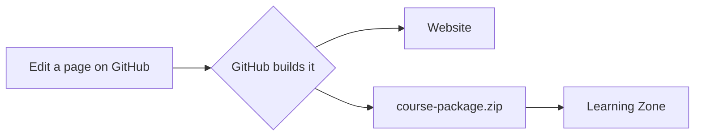
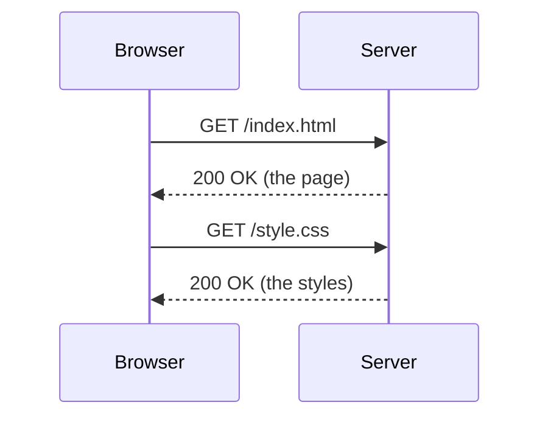
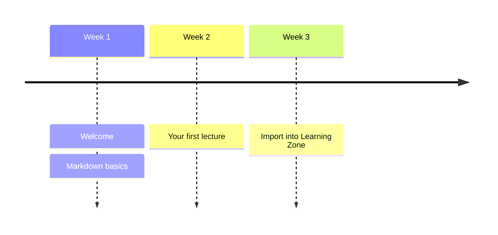

Draw flowcharts, sequence diagrams and timelines by typing a few lines of text.

<!--more-->

## Turn diagrams on

Diagrams use [Mermaid](https://mermaid.js.org). Add one line to the front matter (the part between the `---` lines at the top) of the page:

```yaml
mermaid: true
```

Then write each diagram in a code block whose language is `mermaid`.
Diagrams work on exercise pages, on the website and in Learning Zone.

## A flowchart

````markdown

````


`LR` means left to right; use `TD` for top down.
Square brackets make a box, curly brackets a decision, and `-->` an arrow.

## A sequence diagram

Good for anything where messages go back and forth, such as a browser talking to a server.

````markdown

````


## A timeline



## Try it

1. Open `content/writing/diagrams/index.md` in your repository and press the pencil icon.
2. Add a box to the flowchart, for example `lz --> students[Students]`.
3. Commit, wait for the website to update, and look at your diagram.

If a diagram has a mistake, Mermaid shows an error message in its place. The [Mermaid Live Editor](https://mermaid.live) is a quick way to try a diagram out first.
