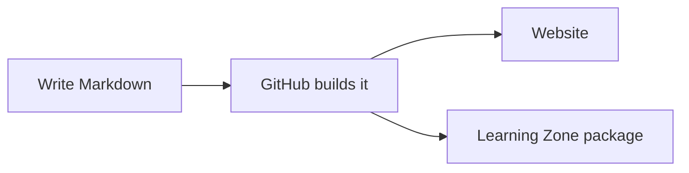

Everything you are likely to need, on one page.

<!--more-->

## Text

| You type | You get |
| --- | --- |
| `*italic*` | *italic* |
| `**bold**` | **bold** |
| `` `code` `` | `code` |
| `[a link](https://www.dmu.ac.uk)` | [a link](https://www.dmu.ac.uk) |

Leave an empty line between paragraphs.

## Headings

```markdown
## A main heading
### A smaller heading
```

Start at `##`, because the page title is already the biggest heading.

## Lists

```markdown
- a bullet point
- another one
  - an indented one

1. a numbered step
2. the next step
```

## Quotes and notes

```markdown
> This stands out from the text around it.
```

> This stands out from the text around it.

## Pictures

```markdown

```

Put the picture file in the same folder as the page's `index.md`.

## Tables

```markdown
| Week | Topic        |
| ---- | ------------ |
| 1    | Introduction |
| 2    | Markdown     |
```

## Code

````markdown
```python
print("Hello")
```
````

Name the language after the backticks (`python`, `java`, `html`, `sql`...) and it is coloured for you.

## Diagrams

You can even draw diagrams from text, using [Mermaid](https://mermaid.js.org).

````markdown

````


## YouTube videos

```markdown

```

Paste the video's id (the part after `v=` in its address).
